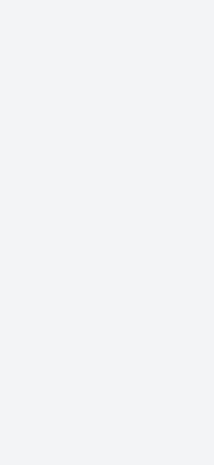
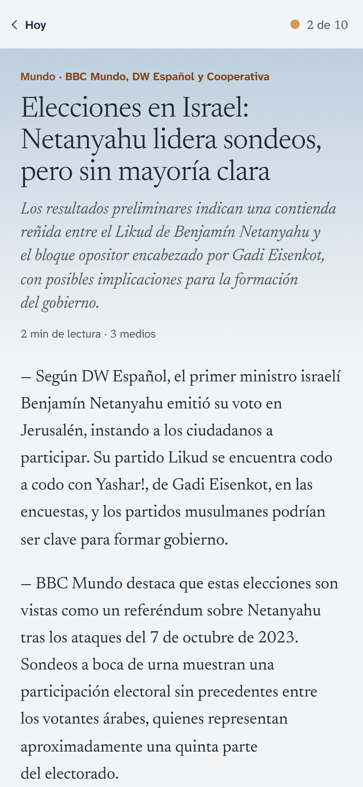
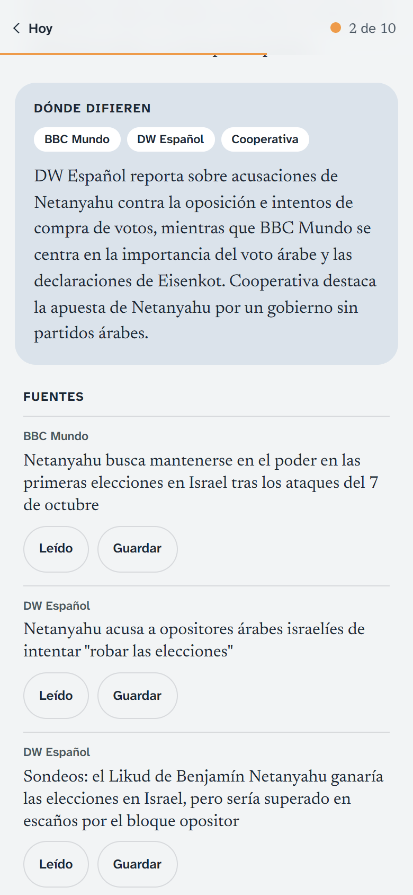
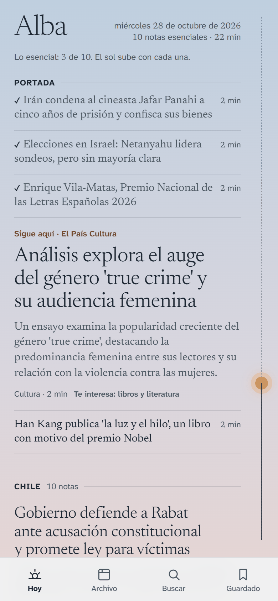
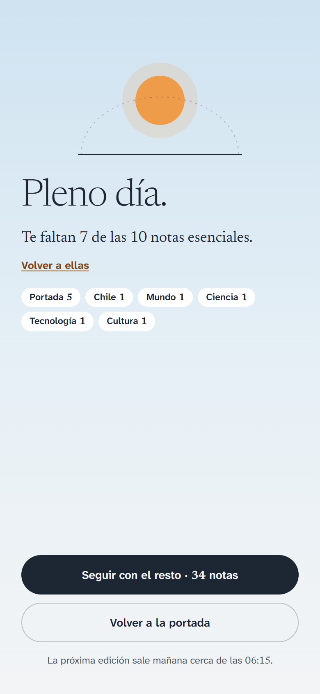
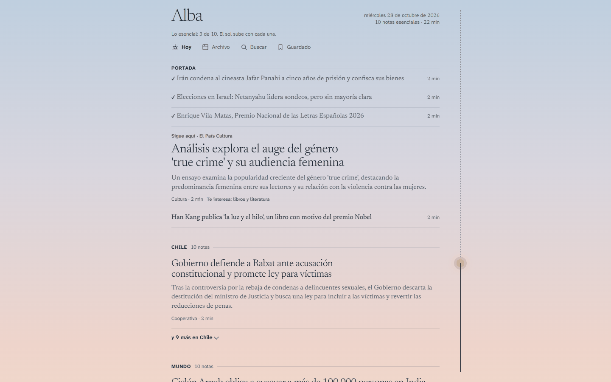
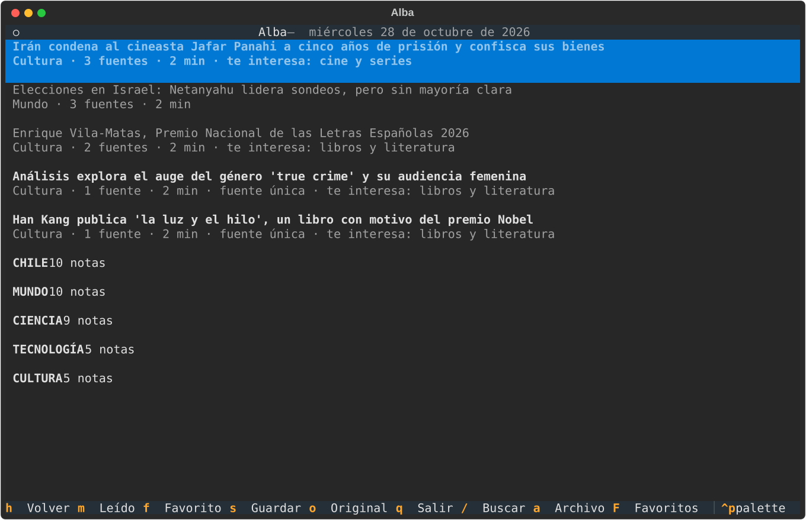
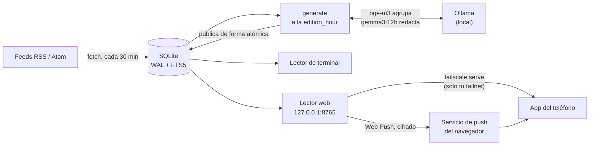
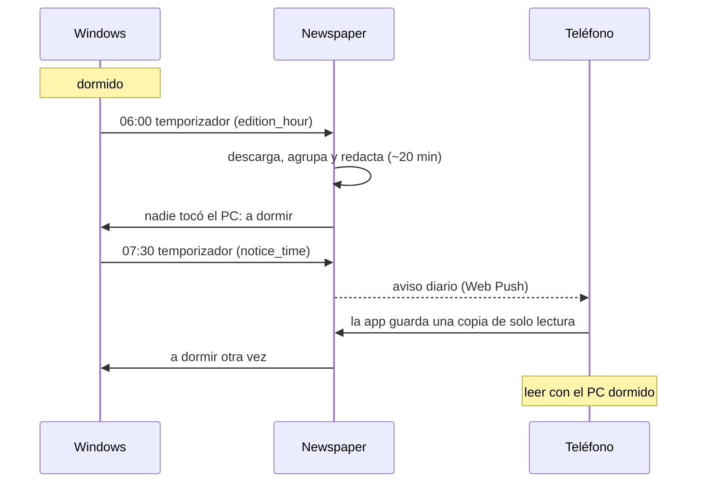

<p align="center">
  <picture>
    <source media="(prefers-color-scheme: dark)" srcset="docs/images/banner-dark.png">
    
  </picture>
</p>

<p align="center">
  <a href="https://github.com/RicketyMajor/newspaper-app/actions/workflows/ci.yml"></a>
  
  
  
  <a href="LICENSE"></a>
</p>

<p align="center"><a href="README.md">English</a> · <b>Español</b></p>

Un diario personal. Defines tus fuentes RSS por sección; cada mañana Newspaper reúne los artículos nuevos, agrupa la cobertura de cada acontecimiento y le pide a un **modelo de lenguaje local** que escriba una nota integrada por acontecimiento: qué pasó, en qué difieren los medios y un enlace a cada original. Se lee en la terminal, en una página web local o en el teléfono, como app instalada.

<p align="center">
  
  &nbsp;
  <picture>
    <source media="(prefers-color-scheme: dark)" srcset="docs/images/phone-note-dark.png">
    
  </picture>
  &nbsp;
  <picture>
    <source media="(prefers-color-scheme: dark)" srcset="docs/images/phone-differ-dark.png">
    
  </picture>
</p>

> **Estado:** en uso diario por su autor desde octubre de 2026. Por ahora solo en Windows; la interfaz está en español y las notas se escriben en el idioma que configures.

## Por qué

Los sitios de noticias y los lectores de feeds te entregan el mismo acontecimiento cinco veces, de cinco medios, en cinco pestañas. Newspaper los lee todos y escribe **una nota por acontecimiento**, con un breve «dónde difieren» cuando los medios no coinciden, para que la edición se pueda terminar: unas diez notas esenciales y veinticinco minutos, y después el resto si quieres.

Todo corre en tu propio computador. Los modelos de lenguaje corren en [Ollama](https://ollama.com); no hay cuentas, ni servicios en la nube, ni seguimiento. Las únicas salidas a internet son tus feeds, los artículos originales y (si activas el aviso diario) el servicio de push del propio navegador, cifrado de extremo a extremo.

## Qué hace

- **Una nota por acontecimiento**: artículos agrupados entre medios e idiomas (embeddings multilingües), redactados en tu idioma con titular, bajada, cuerpo, «dónde difieren» y enlaces a cada original.
- **Una edición que se termina**: un núcleo de unas diez notas (la portada y la primera de cada sección); un sol sube mientras lees, hasta «Pleno día».
- **Tres lectores, un solo estado**: un lector de terminal (Textual), uno web local, y esa misma web como app instalable en el teléfono a través de [Tailscale](https://tailscale.com). Las marcas de leída, favorita y guardada se comparten.
- **Una mañana sin manos** (Windows): el PC despierta, escribe la edición, manda el aviso diario y vuelve a dormir cuando nadie lo está usando.
- **Leer sin el PC**: cuando llega el aviso, la app del teléfono guarda una copia de solo lectura de la edición, para leer mientras el PC duerme.
- **Tus intereses**: frases opcionales de «me interesa» y «no me interesa»; el modelo local etiqueta cada acontecimiento con una de ellas y la edición se ordena en consecuencia.
- **Reglas por feed**: descartar o mover artículos según su URL o su título (`exclude`, `route`).

## Capturas

<table>
  <tr>
    <td align="center" width="25%"><picture><source media="(prefers-color-scheme: dark)" srcset="docs/images/phone-today-dark.png"></picture><br><sub>Hoy</sub></td>
    <td align="center" width="25%"><picture><source media="(prefers-color-scheme: dark)" srcset="docs/images/phone-note-dark.png"></picture><br><sub>Una nota</sub></td>
    <td align="center" width="25%"><picture><source media="(prefers-color-scheme: dark)" srcset="docs/images/phone-differ-dark.png"></picture><br><sub>Dónde difieren</sub></td>
    <td align="center" width="25%"><picture><source media="(prefers-color-scheme: dark)" srcset="docs/images/phone-fin-dark.png"></picture><br><sub>Pleno día</sub></td>
  </tr>
</table>

<picture>
  <source media="(prefers-color-scheme: dark)" srcset="docs/images/desktop-today-dark.png">
  
</picture>



<sub>La edición del 28 de octubre de 2026, escrita por `gemma3:12b` a partir de CIPER, Cooperativa, BBC Mundo, DW, El País, elDiario.es y otros. Las capturas siguen el tema claro u oscuro de GitHub, igual que la app.</sub>

## Cómo funciona



1. **Descarga** cada feed RSS/Atom/RDF activo de `newspaper.toml` (cada 30 minutos, para que los feeds cortos no pierdan artículos).
2. **Extrae** el texto público del artículo con trafilatura; si falla, usa el extracto del RSS.
3. **Agrupa** los artículos sobre un mismo acontecimiento: embeddings multilingües (`bge-m3`) y un umbral de similitud coseno.
4. **Elige** una portada (los acontecimientos con más medios y, después, los más recientes) y hasta N notas por sección. Con `[interests]`, el modelo local etiqueta cada acontecimiento: lo «no» va al final y nunca a portada; lo «sí» va primero entre los que tienen tantos medios como él.
5. **Redacta** cada nota con `gemma3:12b`: titular, bajada, cuerpo y «dónde difieren» cuando hay dos medios o más. Una nota fallida o cortada se reintenta una vez.
6. **Publica** la edición de forma atómica en SQLite. Si Ollama no responde, la edición falla y se sigue leyendo la anterior.

### La mañana, en Windows



## Requisitos

- Windows, Python 3.12+
- [Ollama](https://ollama.com) corriendo en el equipo, con los dos modelos (unos 9 GB; una GPU de 12 GB escribe una edición de ~45 notas en ~20 minutos):

```powershell
ollama pull gemma3:12b
ollama pull bge-m3
```

## Instalación

```powershell
git clone https://github.com/RicketyMajor/newspaper-app.git
cd newspaper-app
python -m venv .venv
.venv\Scripts\activate
pip install -e ".[dev]"
newspaper config          # crea ~/.newspaper/newspaper.toml a partir del ejemplo y lo abre
newspaper generate        # la primera edición, ahora
newspaper web             # léela en http://127.0.0.1:8765
newspaper schedule install   # las tareas diarias (ver más abajo)
```

La configuración se busca en `./newspaper.toml` y después en `~/.newspaper/newspaper.toml` (o con `--config RUTA`). El ejemplo trae dieciséis fuentes en cinco secciones: Chile (CIPER, Cooperativa), Mundo (BBC Mundo, DW Español), Ciencia (El País, The Conversation, Xataka Ciencia), Tecnología (El País, Xataka, Genbeta, MIT Technology Review, The Verge) y Cultura (El País, Culto, elDiario.es, The Guardian Books). Las fuentes en inglés se redactan en el idioma configurado, como el resto. Cámbialas por las tuyas.

## Uso

| Comando | Qué hace |
| --- | --- |
| `newspaper generate [--force]` | Prepara la edición de hoy (tarda: una llamada al modelo por nota). |
| `newspaper fetch` | Descarga los feeds y guarda los artículos nuevos (sin modelo). La tarea programada lo corre cada 30 minutos. |
| `newspaper read` | Lector de terminal. |
| `newspaper web [--port 8765]` | Lector web local en `http://127.0.0.1:8765`. |
| `newspaper status` | La edición de hoy, la última lista y el embudo del aviso diario (aviso · llegó · guardada · tocado · abierta · leídas). |
| `newspaper notify` | Manda otra vez el aviso de hoy, ahora, a cada dispositivo suscrito. |
| `newspaper schedule install` | Las tareas programadas de Windows: la edición a la `edition_hour` (despierta el PC), `fetch` cada 30 minutos, el lector web y el aviso a la `notice_time`. Vuelve a correrlo después de actualizar el código o `newspaper.toml`. |
| `newspaper add-feed` / `list-feeds` | Gestiona las fuentes. |

Abrir `read` o `web` después de la `edition_hour` empieza la edición de hoy en segundo plano si todavía no existe; mientras tanto se lee la anterior.

<details>
<summary><b>Teclas de la terminal</b></summary>

| Tecla | Acción |
| --- | --- |
| `j` / `k` | moverse |
| `l` / `Enter` | abrir |
| `h` / `Esc` | volver |
| `m` / `f` / `s` | leída / favorita / guardada (la nota, o la fuente enfocada) |
| `o` | abrir el artículo original en el navegador |
| `/` | buscar en todas las ediciones |
| `a` | archivo |
| `F` / `S` | favoritas / guardadas |
| `g` | la última portada |
| `q` | salir |

El lector web tiene sus propios atajos: pulsa `?` en cualquier página.

</details>

<details>
<summary><b>Leer en el teléfono (Tailscale)</b></summary>

El lector web solo escucha en `127.0.0.1`. [Tailscale](https://tailscale.com) lo publica dentro de tu propia tailnet, nunca en internet:

1. Instala Tailscale en el PC (`winget install Tailscale.Tailscale`) e inicia sesión con la cuenta que usa tu teléfono.
2. En el menú de Tailscale, activa **Run unattended**. En la consola de administración, **desactiva la expiración de la clave** de este PC (las claves expiran a los 180 días por defecto).
3. `tailscale serve --bg --https=443 http://127.0.0.1:8765`, y abre en el teléfono la dirección `https://<pc>.<tailnet>.ts.net` que imprime. Chrome en Android ofrece **Instalar app**.

`newspaper schedule install` mantiene el servidor arriba (la tarea `Newspaper web`). El servidor mantiene el PC despierto mientras se escribe una edición, 20 minutos después, 30 minutos después del aviso y 15 minutos después de cada visita; luego vuelve a dormir un PC que nadie está usando (uno que estás usando sigue prendido, según tu configuración de energía de Windows). Un PC apagado (no dormido) sigue apagado hasta que lo prendas. Los errores van a `web.log`, junto a la base. Ten en cuenta que el certificado HTTPS publica el nombre `<pc>.<tailnet>.ts.net` en los registros públicos de Certificate Transparency.

</details>

<details>
<summary><b>El aviso diario, y leer sin el PC</b></summary>

Al pie de Hoy, **Avisarme cuando salga …** suscribe ese navegador (la app instalada cuenta como uno aparte) a un aviso por Web Push. El aviso va cifrado de extremo a extremo y pasa por el servicio de push del navegador (el de Google, en Chrome): la primera salida del PC a internet que no es un feed. Su clave de firma, `vapid.pem`, está junto a la base. Una clave nueva (tras borrarla y correr `newspaper schedule install`) anula todas las suscripciones; cada dispositivo se suscribe otra vez en su próxima visita a Hoy.

- **Cuándo sale:** sin `notice_time` (en `[general]`), cuando se publica cada edición. Con `notice_time = "07:30"` (`HH:MM` local, hasta las 22:59), la tarea `Newspaper aviso` despierta el PC a esa hora y lo manda, reintentando durante 9 minutos mientras vuelve la red; `generate` y `fetch` se lo dejan a la tarea hasta 5 minutos después de esa hora.
- **Leer sin el PC:** cuando llega el aviso, la app instalada guarda una copia de solo lectura de la última edición y de Guardado (todo o nada; `status` lo muestra como «guardada»). Mientras el PC duerme o no está al alcance, Hoy, sus notas, Pleno día y Guardado se abren desde esa copia, con la línea «Sin el PC: …» al pie de Hoy. El archivo y la búsqueda necesitan el PC. Los artículos originales se siguen abriendo, porque vienen de internet. Las aperturas, las marcas del aviso y las fuentes que abres quedan en una cola con su hora y se mandan cuando el PC vuelve a responder.
- **Los ahorradores de batería de Android** pueden impedir que el aviso se muestre: permite que el navegador que instaló la app se inicie solo y funcione sin restricciones de batería. Un teléfono con poca memoria puede cerrar el navegador antes de que guarde la copia.

</details>

<details>
<summary><b>Opciones de configuración</b></summary>

`[edition]` en `newspaper.toml`:

- `cluster_threshold` (por defecto `0.75`): súbelo si se mezclan historias distintas; bájalo si un mismo acontecimiento sale en varias notas.
- `front_page_size`, `max_notes_per_section`, `window_hours`.
- `section_limits = { "Cultura" = 5 }`: una sección con su propio tope en vez de `max_notes_per_section`.

Por feed (`[[feeds]]`), reglas opcionales: expresiones regulares que se buscan (sin distinguir mayúsculas) en la URL y el título de cada artículo, aplicadas a los artículos recién descargados.

- `exclude = ["/deportes/"]`: descarta los artículos que coinciden; nunca se guardan, ni se extraen, ni se redactan.
- `route = { "/mundo/" = "Mundo" }`: mueve los artículos que coinciden a otra sección (gana la primera coincidencia; `exclude` va antes).

`[interests]` opcional (ver el ejemplo comentado): listas `like` y `dislike` de frases cortas. `gemma3:12b` elige el tema principal de cada acontecimiento entre ellas y unos pocos temas neutros fijos (una llamada rápida por acontecimiento, ~1,5 s cada una); una historia que encaja en las dos listas cuenta como «no». Cada nota muestra su etiqueta («Te interesa: …» / «Menos interés: …»).

</details>

## Hoja de ruta

- Un aviso que sobreviva a los teléfonos con poca memoria (la copia para leer sin el PC).
- Marcas de leída que vuelvan desde la copia sin conexión.
- Un botón «No me interesa» que baje las historias parecidas.
- Una nota por historia en desarrollo, e imágenes de los medios.
- Secciones por tema, y gestionar fuentes e intereses desde la web.
- Más conectores (Hacker News, GitHub), otros motores de IA local, Linux y macOS, y un paquete en PyPI.

## Desarrollo

```powershell
pytest                       # 340 tests; sin red ni Ollama
ruff check src tests
ruff format --check src tests
```

El CI corre los tres en Windows con cada push a `master`.

## Licencia

[MIT](LICENSE) © 2026 Alonso Vera. Las fuentes tipográficas incluidas (Newsreader y Atkinson Hyperlegible Next) tienen la licencia SIL Open Font License; ver `src/newspaper/web/static/fonts/`.
