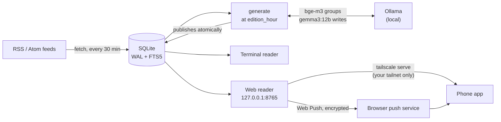
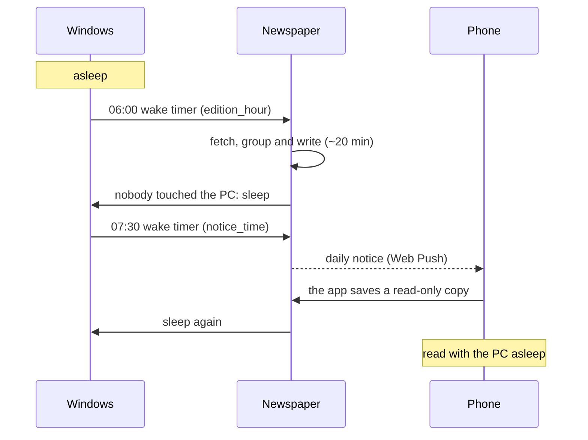

<p align="center">
  <picture>
    <source media="(prefers-color-scheme: dark)" srcset="docs/images/banner-dark.png">
    
  </picture>
</p>

<p align="center">
  <a href="https://github.com/RicketyMajor/newspaper-app/actions/workflows/ci.yml"></a>
  
  
  
</p>

<p align="center"><b>English</b> · <a href="README.es.md">Español</a></p>

A personal daily newspaper. You list your RSS sources by section; every morning Newspaper gathers the new articles, groups the coverage of each event, and has a **local LLM** write one integrated note per event: what happened, where the outlets differ, and a link to every original. Read it in the terminal, in a local web page, or on your phone as an installed app.

<p align="center">
  
  &nbsp;
  <picture>
    <source media="(prefers-color-scheme: dark)" srcset="docs/images/phone-note-dark.png">
    
  </picture>
  &nbsp;
  <picture>
    <source media="(prefers-color-scheme: dark)" srcset="docs/images/phone-differ-dark.png">
    
  </picture>
</p>

> **Status:** in daily use by its author since October 2026. Windows only for now; the interface is in Spanish, and notes are written in the language you configure.

## Why

News sites and feed readers hand you the same event five times, from five outlets, in five tabs. Newspaper reads them all and writes **one note per event**, with a short "where they differ" when outlets disagree, so the edition can be finished: about ten essential notes and twenty-five minutes, then the rest if you want it.

Everything runs on your own computer. The language models run in [Ollama](https://ollama.com); there are no accounts, no cloud services, and no tracking. The only outbound requests are your feeds, the original articles, and (if you turn on the daily notice) the browser's own push service, end-to-end encrypted.

## Features

- **One note per event**: articles grouped across outlets and languages (multilingual embeddings), written in your language with headline, dek, body, "where they differ" and links to every original.
- **A finishable edition**: a core of about ten notes (the front page plus the first of each section); a sun climbs as you read, up to "Pleno día" (full day).
- **Three readers, one state**: a terminal reader (Textual), a local web reader, and the same web as an installable app on your phone through [Tailscale](https://tailscale.com). Read, favorite and saved marks are shared.
- **A hands-free morning** (Windows): the PC wakes up, writes the edition, sends the daily notice, and goes back to sleep when nobody is using it.
- **Reading without the PC**: when the notice arrives, the phone app keeps a read-only copy of the edition, so you can read while the PC sleeps.
- **Your interests**: optional "like" and "dislike" phrases; the local model tags each event with one of them, and the edition is ordered accordingly.
- **Per-feed rules**: drop or reroute articles by URL or title (`exclude`, `route`).

## Screenshots

<table>
  <tr>
    <td align="center" width="25%"><picture><source media="(prefers-color-scheme: dark)" srcset="docs/images/phone-today-dark.png"></picture><br><sub>Today</sub></td>
    <td align="center" width="25%"><picture><source media="(prefers-color-scheme: dark)" srcset="docs/images/phone-note-dark.png"></picture><br><sub>A note</sub></td>
    <td align="center" width="25%"><picture><source media="(prefers-color-scheme: dark)" srcset="docs/images/phone-differ-dark.png"></picture><br><sub>Where they differ</sub></td>
    <td align="center" width="25%"><picture><source media="(prefers-color-scheme: dark)" srcset="docs/images/phone-fin-dark.png"></picture><br><sub>Full day</sub></td>
  </tr>
</table>

<picture>
  <source media="(prefers-color-scheme: dark)" srcset="docs/images/desktop-today-dark.png">
  
</picture>


<sub>The edition of 28 October 2026, as written by `gemma3:12b` from CIPER, Cooperativa, BBC Mundo, DW, El País, elDiario.es and others. The screenshots follow GitHub's light or dark theme, like the app does.</sub>

## How it works



1. **Fetch** every enabled RSS/Atom/RDF feed in `newspaper.toml` (every 30 minutes, so short feeds don't lose articles).
2. **Extract** the public article text with trafilatura; fall back to the RSS excerpt.
3. **Group** articles about the same event: multilingual embeddings (`bge-m3`) and a cosine-similarity threshold.
4. **Select** a front page (events covered by the most outlets, then the most recent) and up to N notes per section. With `[interests]`, the local model tags each event: "dislike" ones go last and never to the front page, "like" ones go first among events covered by as many outlets.
5. **Write** each note with `gemma3:12b`: headline, dek, body, and "where sources differ" when there are two or more outlets. A failed or truncated note is retried once.
6. **Publish** the edition atomically in SQLite. If Ollama is down the edition fails and the previous one stays readable.

### The morning, on Windows



## Requirements

- Windows, Python 3.12+
- [Ollama](https://ollama.com) running locally, with the two models (about 9 GB; a GPU with 12 GB writes an edition of ~45 notes in ~20 minutes):

```powershell
ollama pull gemma3:12b
ollama pull bge-m3
```

## Install

```powershell
git clone https://github.com/RicketyMajor/newspaper-app.git
cd newspaper-app
python -m venv .venv
.venv\Scripts\activate
pip install -e ".[dev]"
newspaper config          # creates ~/.newspaper/newspaper.toml from the example and opens it
newspaper generate        # the first edition, now
newspaper web             # read it at http://127.0.0.1:8765
newspaper schedule install   # the daily tasks (see below)
```

The configuration is looked up in `./newspaper.toml`, then `~/.newspaper/newspaper.toml` (or pass `--config PATH`). The example ships sixteen sources in five sections: Chile (CIPER, Cooperativa), Mundo (BBC Mundo, DW Español), Ciencia (El País, The Conversation, Xataka Ciencia), Tecnología (El País, Xataka, Genbeta, MIT Technology Review, The Verge) and Cultura (El País, Culto, elDiario.es, The Guardian Books). English sources are written up in the configured language like the rest. Replace them with your own.

## Use

| Command | What it does |
| --- | --- |
| `newspaper generate [--force]` | Prepare today's edition (takes a while: one LLM call per note). |
| `newspaper fetch` | Fetch the feeds and store new articles (no LLM). The scheduled task runs it every 30 minutes. |
| `newspaper read` | Terminal reader. |
| `newspaper web [--port 8765]` | Local web reader at `http://127.0.0.1:8765`. |
| `newspaper status` | Today's edition, the latest ready one, and the daily notice's funnel (sent · arrived · saved · tapped · opened · read). |
| `newspaper notify` | Send today's notice again, now, to every subscribed device. |
| `newspaper schedule install` | The Windows scheduled tasks: the edition at `edition_hour` (wakes the PC), `fetch` every 30 minutes, the web reader, and the notice at `notice_time`. Run it again after updating the code or `newspaper.toml`. |
| `newspaper add-feed` / `list-feeds` | Manage sources. |

Opening `read` or `web` after `edition_hour` starts today's edition in the background if it does not exist yet; meanwhile you read the previous one.

<details>
<summary><b>Terminal keys</b></summary>

| Key | Action |
| --- | --- |
| `j` / `k` | move |
| `l` / `Enter` | open |
| `h` / `Esc` | back |
| `m` / `f` / `s` | read / favorite / saved (note, or the focused source) |
| `o` | open the original article in the browser |
| `/` | search every edition |
| `a` | archive |
| `F` / `S` | favorites / saved |
| `g` | latest front page |
| `q` | quit |

The web reader has its own shortcuts: press `?` on any page.

</details>

<details>
<summary><b>Read on your phone (Tailscale)</b></summary>

The web reader only listens on `127.0.0.1`. [Tailscale](https://tailscale.com) publishes it inside your own tailnet, never on the internet:

1. Install Tailscale on the PC (`winget install Tailscale.Tailscale`) and sign in with the account your phone uses.
2. In the Tailscale menu, turn on **Run unattended**. In the admin console, **disable key expiry** for this PC (keys expire after 180 days by default).
3. `tailscale serve --bg --https=443 http://127.0.0.1:8765`, then open the `https://<pc>.<tailnet>.ts.net` address it prints on your phone. Chrome on Android offers **Install app**.

`newspaper schedule install` keeps the server running (the `Newspaper web` task). The server keeps the PC awake while an edition is written, 20 minutes after it, 30 minutes after the notice and 15 minutes after each visit; then it puts back to sleep a PC nobody is using (one you are using stays on, per your Windows power settings). A PC that was shut down (not asleep) stays off until you turn it on. Errors go to `web.log`, next to the database. Note that the HTTPS certificate publishes the `<pc>.<tailnet>.ts.net` name in public Certificate Transparency logs.

</details>

<details>
<summary><b>The daily notice, and reading without the PC</b></summary>

At the foot of Today, **Avisarme cuando salga …** subscribes that browser (the installed app counts as its own) to a Web Push notice. The notice is end-to-end encrypted and goes through the browser's push service (Google's, for Chrome): the PC's first outbound request that isn't a feed. Its signing key, `vapid.pem`, sits next to the database. A new key (after deleting it and running `newspaper schedule install`) voids every subscription; each device subscribes again on its next visit to Today.

- **When it goes out:** without `notice_time` (in `[general]`), when each edition is published. With `notice_time = "07:30"` (local `HH:MM`, up to 22:59), the `Newspaper aviso` task wakes the PC at that time and sends it, retrying for 9 minutes while the network comes back; `generate` and `fetch` leave it to the task until 5 minutes past that time.
- **Reading without the PC:** when the notice arrives, the installed app saves a read-only copy of the latest edition and of Guardado (all or nothing; `status` shows it as «guardada»). While the PC sleeps or is out of reach, Today, its notes, Pleno día and Guardado open from that copy, with the line «Sin el PC: …» at the foot of Today. Archive and search need the PC. The original articles still open, since they come from the internet. Openings, the notice's marks and the sources you open are queued with their time and sent when the PC answers again.
- **Android battery savers** can keep the notice from showing: allow the browser that installed the app to start on its own and to run without battery restrictions. A phone short on memory may still close the browser before it saves the copy.

</details>

<details>
<summary><b>Configuration knobs</b></summary>

`[edition]` in `newspaper.toml`:

- `cluster_threshold` (default `0.75`): raise it if unrelated stories get merged, lower it if the same event appears as several notes.
- `front_page_size`, `max_notes_per_section`, `window_hours`.
- `section_limits = { "Cultura" = 5 }`: a section with its own cap instead of `max_notes_per_section`.

Per feed (`[[feeds]]`), optional rules: regexes searched (case-insensitive) in each article's URL and title, applied to newly fetched articles.

- `exclude = ["/deportes/"]`: drop matching articles; they are never stored, extracted or written.
- `route = { "/mundo/" = "Mundo" }`: move matching articles to another section (first match wins; `exclude` goes first).

Optional `[interests]` (see the commented example): `like` and `dislike` lists of short phrases. `gemma3:12b` picks each event's main topic among them plus a few fixed neutral topics (one quick call per event, about 1.5 s each); a story that fits both lists counts as "dislike". Each note shows its label ("Te interesa: …" / "Menos interés: …").

</details>

## Roadmap

- A notice that survives phones short on memory (the copy for reading without the PC).
- Read marks that sync back from the offline copy.
- A "Not interested" button that lowers similar stories.
- One note per developing story, and images from the outlets.
- Sections by topic, and managing sources and interests from the web.
- More connectors (Hacker News, GitHub), other local LLM backends, Linux and macOS, and a PyPI package.

## Development

```powershell
pytest                       # 340 tests; no network or Ollama needed
ruff check src tests
ruff format --check src tests
```

CI runs the same three on Windows for every push to `master`.

## Fonts

The bundled fonts (Newsreader and Atkinson Hyperlegible Next) are under the SIL Open Font License; see `src/newspaper/web/static/fonts/`.
